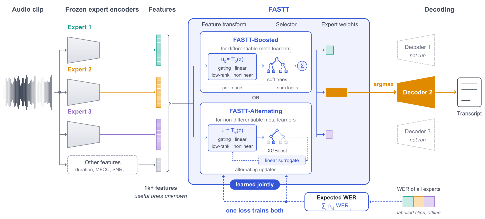

<div align="center">

<h1>FASTT: Feature-Adaptive Speech-to-Text Model Selection</h1>

**Under review · Expert Systems with Applications**

[Huseyin Karaca](https://hkaraca.com/), A. Samil Namli, Suleyman S. Kozat<br>
Bilkent University

[Paper](https://hkaraca.com/fastt/assets/fastt.pdf) ·
[Project page](https://hkaraca.com/fastt/) ·
[Data](https://huggingface.co/datasets/huseyin-karaca/fastt)

</div>

Pretrained speech recognizers have complementary strengths: on any one clip, one of them is often clearly better
than the others. FASTT picks that expert per clip. It reads the experts' own **encoder states**, averaged over the
clip, reshapes them with a **learned feature transformation**, and scores the experts with a selector; the
transformation and the selector are trained together to minimise the **expected word error rate** of the choice. The
choice is made before any decoder runs, so only the chosen expert's decoder runs.

<p align="center"></p>

## Reproduce the paper

The main experiment is one notebook per corpus. Every method's hyperparameters are selected on a 25 % hold-out of
the corpus; every method is then trained and tested on the same ten folds of a 5×2 cross-validation of the remaining
clips, and compared with the corpus's FASTT anchor on those folds.

| Notebook | What it reproduces | |
|---|---|---|
| [`main_librispeech`](notebooks/main_librispeech.ipynb) | Tables 1, 2, 3 and 6 on LibriSpeech | [](https://colab.research.google.com/github/huseyin-karaca/fastt/blob/main/notebooks/main_librispeech.ipynb) |
| [`main_voxpopuli`](notebooks/main_voxpopuli.ipynb) | the same on VoxPopuli | [](https://colab.research.google.com/github/huseyin-karaca/fastt/blob/main/notebooks/main_voxpopuli.ipynb) |
| [`main_ami_sdm`](notebooks/main_ami_sdm.ipynb) | the same on AMI (single distant microphone) | [](https://colab.research.google.com/github/huseyin-karaca/fastt/blob/main/notebooks/main_ami_sdm.ipynb) |
| [`main_earnings22`](notebooks/main_earnings22.ipynb) | the same on Earnings-22 | [](https://colab.research.google.com/github/huseyin-karaca/fastt/blob/main/notebooks/main_earnings22.ipynb) |
| [`main_peoples_speech`](notebooks/main_peoples_speech.ipynb) | the same on People's Speech | [](https://colab.research.google.com/github/huseyin-karaca/fastt/blob/main/notebooks/main_peoples_speech.ipynb) |
| [`ablation`](notebooks/ablation.ipynb) | the feature transformation and the training objective (Table 5) | [](https://colab.research.google.com/github/huseyin-karaca/fastt/blob/main/notebooks/ablation.ipynb) |
| [`timing`](notebooks/timing.ipynb) | the inference cost (Table 4) | [](https://colab.research.google.com/github/huseyin-karaca/fastt/blob/main/notebooks/timing.ipynb) |
| [`manuscript_tables`](notebooks/manuscript_tables.ipynb) | every table of the paper, written to [`tables/`](tables) | [](https://colab.research.google.com/github/huseyin-karaca/fastt/blob/main/notebooks/manuscript_tables.ipynb) |
| [`extract`](notebooks/extract.ipynb) | the experts' outputs, rebuilt from the audio (level 3) | [](https://colab.research.google.com/github/huseyin-karaca/fastt/blob/main/notebooks/extract.ipynb) |

Each notebook runs at one of three levels (`LEVEL` in its first cell):

| Level | What runs | Needs |
|---|---|---|
| **1** | every table, from the searches, folds and records stored on the Hub | a CPU, minutes |
| **2** | every fold refitted from the published features | a CPU, hours |
| **3** | level 2 on features rebuilt from the audio (`extract`) | a GPU for `extract` |

No level needs an account or a token. The notebooks are committed with the outputs of a level-1 run, which
reproduces every table of the paper exactly.

Locally:

```bash
pip install "fastt[paper] @ git+https://github.com/huseyin-karaca/fastt"
python -m fastt.experiment ami_sdm        # level 1 of main_ami_sdm as a script
```

## What is where

```
notebooks/        the notebooks
tables/           the paper's tables as LaTeX, written by notebooks/manuscript_tables
src/fastt/        the configurations (configs), the main experiment (experiment), FASTT and every baseline, the
                  search, the cross-validation, the paired tests, the ablation, the cost, the tables (paper)
docs/             the project page: one static index.html and its assets
notes/            the long-form notes behind it: method, results, reproduction, data, notebooks, package
```

The data — the audio at 16 kHz, every expert's transcripts, word-error counters and pooled encoder states, and the
stored searches, folds and records — is the Hugging Face dataset
[`huseyin-karaca/fastt`](https://huggingface.co/datasets/huseyin-karaca/fastt). Each corpus's part carries that
corpus's licence; see [`notes/data.md`](notes/data.md).

## Citation

See [`CITATION.cff`](CITATION.cff).

## Licence

The code is Apache-2.0 ([`LICENSE`](LICENSE)). The data on the Hub keeps the licence of the corpus it comes from.
